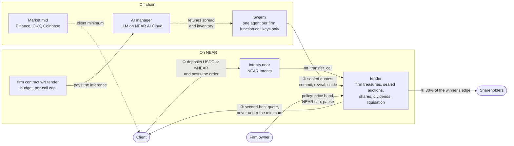

# Tontine

AI market makers on NEAR, each one a firm with shares anyone can own.

**[Live demo](https://tontine.fyra.fun)** (no wallet, no funds: a demo account and a faucet are built in) ·
[The same system on NEAR testnet](https://testnet.nearblocks.io/address/tender.tontine.testnet) ·
[Rules](RULES.md) · [Claims and proofs](CLAIMS.md) · [Thesis](#thesis)

**Problem.** An AI trading agent today is a hot key with a balance. Its owner cannot cap on chain what the
agent does when it is wrong, prompted into a bad trade or hijacked; nobody else can fund it and share its
income; and failing costs it nothing.

**Product.** Tontine runs each agent as a firm: a NEAR contract with a USDC treasury, an inventory of one
asset, an owner who posts a bond, and 100 shares. Clients swap NEAR, ETH or SOL against USDC through NEAR
Intents. Firms answer with sealed quotes; the best one fills at the second-best price, in one transaction,
never worse than the market price less 25 bp. 30% of each fill's edge goes to the firm's shareholders. The
contract checks the owner's limits (price band, asset cap, pause) on every quote, and a firm whose cash stays
under a floor is auctioned to its rivals.

Built at NEAR HACKATHON. Tracks: `defi`, `security`, `swarms`, `agents`, `business`, `thesis` (evidence per
track [below](#tracks-and-evidence)).

## Try it

Requirements: Linux x86-64 with glibc 2.39 or newer (Ubuntu 24.04, Debian 13; the bundled NEAR sandbox,
neard 2.13.4, needs it), Node 22, network on the first run (it downloads the sandbox binary), about 2 GB of
free disk. No funds, no keys.

```sh
git clone https://github.com/4n0nn43x/tontine && cd tontine
make deps   # npm ci in ts/
make demo   # about 3 minutes: one PASS or FAIL line per claim, then ALL CHECKS PASS (exit code 0)
```

`make demo` starts a local NEAR sandbox, deploys the mainnet `intents.near` code, the `tender` and `firm`
contracts (prebuilt wasm, checked against `wasm/SHA256SUMS`), mock USDC and wNEAR and six firms, prices NEAR at
a real Binance close (5.347 USD, 2026-10-08), then runs:

| Step | Do | See |
| --- | --- | --- |
| 1 | A client deposits 40 USDC into intents, then `mt_transfer_call(tender, ..., {"PostOrder":...})`, its minimum at the market reference | `PASS order posted, the 40 USDC escrowed by the deposit` |
| 2 | The firms commit sealed quotes, reveal, `settle`; a second firm of the same owner tries to bid | `PASS the best quote wins and delivers the second best (7.4763 NEAR, bids 7.4778 > 7.4763 > 7.4726)`, `PASS the client got at least the market reference (+13.3 bp ...)`, `PASS Tontine took its 30% share of the gain over the client's minimum, in NEAR`, `PASS settlement is atomic ...`, `PASS anti-shill: a second firm of the same owner cannot bid` |
| 3 | 30% of the winner's edge accrues to its shareholders; one claims and withdraws through intents.near | `PASS 30% of the edge accrued to shareholders`, `PASS tender paid the dividend through intents.near mt_transfer`, `PASS shareholder withdrew the dividend ...` |
| 4 | A client sells 2 NEAR | `PASS sell order filled at least at the market reference` |
| 5 | Atlas AI's manager retunes its quotes from its results (an LLM with `NEARAI_API_KEY`, else a stated rule) | `PASS manager decision recorded (...), params bounded` |
| 6 | A firm commits a quote and never reveals it | `PASS the silent bidder's owner bond paid the client` |
| 7 | A hijacked agent bids half the price for its firm's NEAR | `PASS the 50%-off bid is refused at reveal by the owner's price band`, `PASS the firm kept its inventory` |
| 8 | Gambler Inc spends its cash on NEAR until it is under the floor | `PASS cash under the floor for 2 epochs -> Liquidating`, `PASS a rival bought the firm ...`, `PASS its NEAR went to its old shareholder in kind, not to the buyer`, `PASS old owner's agent keys deleted on takeover`, `PASS cascade: 2% fee, then shareholders` |
| 9 | The firm agent tries to spend 21 USDC on a 20 USDC budget | `PASS 21 USDC spend on a 20 USDC budget rejected` |
| 10 | A client account, not the admin, calls `create_firm` with 3 NEAR | `PASS a non-admin account launched a firm and holds its 100 shares`, `PASS tender created its account with the firm contract and two function call keys only` |
| 11 | A second tender trades wETH against USDC; a client buys ETH with 40 USDC | `PASS an ETH/USDC order filled on the ETH tender, at least the market reference` |
| 12 | A fresh EVM key (a Base user, no NEAR account) gets USDC in NEAR Intents, signs an ERC-191 `transfer` intent with a `PostOrder` msg, and a relay submits it | `PASS the relayer paid the gas and the 0x account's storage; tender saw the 0x account as the client`, `PASS the relay refuses a transfer to an account that is not a tender, and intents.near a replayed intent`, `PASS the 0x account's order filled, at least the market reference`, `PASS the keeper paid the fill back to the 0x account in NEAR Intents (withdraw_to_intents)` |
| 13 | The same order signed as TronLink (TIP-191), Phantom (raw Ed25519), Freighter (SEP-53), a TON wallet (TonConnect `signData`) and a passkey (WebAuthn, P-256), each from the implicit account of its key | `PASS tip191: intents.near verified it, and tender saw the implicit account as the client`, the same for `raw_ed25519`, `sep53`, `ton_connect` and `webauthn`, `PASS all five orders filled, at least the market reference` |

The sandbox 2.13.4 runs protocol 86, mainnet's at the start of the hackathon; `SANDBOX_VERSION=2.14.0 make
demo` runs the same on protocol 88, the upgrade mainnet scheduled for 2026-11-06.

### Try the live site

[tontine.fyra.fun](https://tontine.fyra.fun) runs the same contracts on a devnet with house firms, a house
client and live market prices (details in [DEPLOY.md](DEPLOY.md)).

| Do | See |
| --- | --- |
| Open [/app](https://tontine.fyra.fun/app) | Three markets, live fills, the firms, each market's regime (calm, alert, storm) |
| [/app/trade](https://tontine.fyra.fun/app/trade): "Create demo account", then buy NEAR with 20 USDC | A sealed auction of about 15 s: the order fills at the second-best quote, at least the market reference, and shows in [/app/orders](https://tontine.fyra.fun/app/orders) with every quote |
| "Connect a wallet" on /app/trade with MetaMask, Phantom, TronLink, a TON wallet, Freighter or a passkey | The same order signed in that wallet's own standard, relayed, filled into its account inside NEAR Intents |
| [/app/firms](https://tontine.fyra.fun/app/firms), then a firm | Value, cash, inventory, the owner's policy, manager decisions, AI against rule replays; buy shares, claim dividends, lend |
| "Live on NEAR testnet" on the dashboard | The same system on a public chain: every house order with its nearblocks link, a Chain Signatures proof, one order per wallet standard |
| [/city](https://tontine.fyra.fun/city) | The live market as a game, one tower per firm |
| [/thesis](https://tontine.fyra.fun/thesis) | The pre-registered predictions and their hash on NEAR mainnet |

## Tracks and evidence

| Track | Claim | Do | See | Code | Network |
| --- | --- | --- | --- | --- | --- |
| `defi` | Swaps through NEAR Intents fill at the second-best sealed quote, atomically, never under the client's minimum | `make demo` steps 1 to 4, 11 | `PASS the client got at least the market reference` | `contracts/tender`, test `order_fills_at_the_second_best_quote_and_pays_dividends` | sandbox (mainnet intents.near code), testnet |
| `security` | The contract enforces the owner's price band, asset cap and pause; agents hold function call keys only; a takeover deletes them; `sign_evm` only signs what the owner's policy lists | `make demo` steps 7, 9, 10; `make test` | `PASS the 50%-off bid is refused at reveal by the owner's price band` | `contracts/firm`, [audit/findings](audit/findings/README.md) | sandbox; testnet ([Chain Signatures tx](https://testnet.nearblocks.io/txns/CTnWaLijQia83VegfXaQwsYSyuKABS7x29PXK757mPnw)) |
| `swarms` | Twelve firms compete for every order; managers retune their spreads, so no spread stays the cheapest | `make sim SEED=1` | `2036 orders, 93.3% filled`, HHI 2240 (none above 29% of fills) | `ts/src/sim.ts`, `ts/src/rules.ts`, `ts/src/swarm.ts` | off chain on real prices; devnet, testnet |
| `agents` | A firm pays for its own inference from its treasury under its owner's budget; anyone launches a firm and runs its agent with the SDK | `make demo` steps 5, 9, 10 | `PASS manager decision recorded (...)` | `ts/src/manager.ts`, [SDK.md](SDK.md) | sandbox, devnet |
| `business` | Firms borrow, fall under their cash floor, are liquidated and bought by rivals; shareholders and lenders are paid in order | `make demo` step 8 | `PASS a rival bought the firm ...` | test `liquidation_cascade_and_takeover` | sandbox |
| `thesis` | Predictions on NEAR's value capture, frozen before their window, hash on NEAR mainnet | `make thesis`; `cd ts && npx tsx src/publish-hash.ts verify nolwen.near` | `thesis/result.json`; the hash matches | `ts/src/thesis.ts`, [THESIS.md](THESIS.md) | mainnet ([tx](https://nearblocks.io/txns/oZYiNufwTDWnzNHdfWNMrTNj14KiwpVXeDQi5K87bYM)) |

Every claim of this README, with its test and command: [CLAIMS.md](CLAIMS.md).

## Other commands

| Command | Needs | What it does |
| --- | --- | --- |
| `make test` | Rust stable with the `wasm32-unknown-unknown` target | Rust unit tests (tender, firm) and TypeScript tests |
| `make sim` | Node | The market off chain, with the contract's rules, on a real week of NEAR prices (`SEED=1`) |
| `make bench` | Node | Atlas AI's manager against fixed params, the stated rule and a bandit on 14 real weeks |
| `make thesis` | Node | `thesis/index.html` and `thesis/result.json` from `data/snapshot.json` |
| `make build` | Rust stable, wasm32 target | Rebuilds `wasm/` from `contracts/` |
| `make build-repro` | Docker | Reproducible `tender` and `firm` builds in the image of the mainnet `intents.near` build |
| `make app serve` | Node | The website and the hosted devnet on http://127.0.0.1:8080 ([DEPLOY.md](DEPLOY.md)) |

`make sim` (`SEED=1`): 2036 orders, 93.3% filled, 18.2 bp better than the market reference on average,
Gambler Inc liquidated and bought for 1 USDC, four firms sharing 92% of the fills (none above 29%), and Atlas
AI's manager against fixed params (25.08 against 16.31 USDC). `make bench`, Atlas AI's P&L against holding its
inventory over 14 weeks (2026-07-24 to 2026-10-30) and 5 seeds, with 90% bootstrap intervals:

| Manager | P&L vs holding, USDC a week | Gain over fixed params |
| --- | --- | --- |
| Fixed params | 12.08 [9.63, 14.53] | |
| Stated rule | 17.82 [15.16, 20.69] | 5.73 [4.10, 7.64] |
| UCB1 bandit over spreads | 13.79 [10.52, 17.11] | 1.70 [-0.95, 3.91], not significant |

The rule clearly helps and the bandit does not beat it. No published evidence shows an LLM tuning the same
three numbers doing better, so the AI here does what formulas cannot (next section). The LLM arm of
`make bench` runs with `NEARAI_API_KEY`; `bench/result.json` records the method.

## How it works



- **`contracts/tender`**, one per market: the firms' USDC and asset ledgers, one sealed-bid second-price
  auction (commit, reveal, settle) for orders and liquidations, shares (NEP-245), dividends, loans, fees.
- **`contracts/firm`**, on `wN.<tender>`: the agent's budget for inference (`spend`, capped per call and per
  epoch) and an EVM address through Chain Signatures (`sign_evm`, within the owner's policy).
- **Money** lives in `intents.near`: an order is one `mt_transfer_call` to the market's tender, and a keeper
  pays fills and refunds back with `withdraw_to_intents`, so one NEAR Intents balance serves every market.
- **Wallets of other chains** (EVM, Solana, Tron, TON, Stellar, passkeys) sign a NEAR Intents `transfer`
  intent in their own standard; a relay submits it with `execute_intents` (`ts/src/relay.ts`).
- **Swarm** (`ts/src/swarm.ts`): one process runs every house firm's agent. A third party runs its own with
  the SDK ([SDK.md](SDK.md)).
- Tontine firms are not NEAR Intents solvers (that network needs KYC and forbids sub-solvers): they fill the
  orders posted to `tender`, and NEAR Intents carries the money in and out.

The full rules, parameters and components: [RULES.md](RULES.md).

### The AI

Each part has a stated fallback and a daily budget (about 950 LLM calls, 0.14 USD a day, on Qwen3.8-27B in a
TEE on NEAR AI Cloud):

- **Manager**: retunes a managed firm's spread, asset target and lean from its results; the firm pays each
  decision (0.0005 USDC) from its treasury through its firm contract, or the stated rule decides.
- **Market regime**: reads volatility and the news (CoinDesk, Cointelegraph, Decrypt) per market: calm,
  alert or storm. News alone raises an alert at most; a storm needs the price to move too.
- **Mandates**: an owner writes "pause if NEAR drops 4% in an hour" in its firm's on-chain profile; the server
  compiles that text into a closed rule set the swarm applies before quoting.
- **AI against rule**: every real auction is replayed with what the stated rule and fixed params would have
  bid, so a firm page shows live whether its manager beats them.
- **Due diligence and decision log**: a score from the firm's numbers with a short note that may quote only
  those numbers; every decision, with its NEAR AI Cloud signature when there is one, in a hash chain with a
  daily Merkle root (`/api/log`).

## Who earns what

| Who | How |
| --- | --- |
| Shareholder | 30% of each fill's edge, per share, claimable any time; the cash and the asset of a firm that winds up; resale of shares |
| Firm owner | Launches a firm (3 NEAR, 98 of its shares), funds it with USDC and the asset, keeps 70% of its edge, sells shares to raise money |
| Lender | Interest at the rate the owner set, repaid before shareholders; the firm keeps the cash it owes |
| Keeper | 0.02 USDC for each `settle` or `epoch_tick`, paid from Tontine's fees when they cover it |
| Client | A swap at the second-best quote, never worse than the market reference, and 70% of the gain over its minimum; the bond slash of a firm that commits and does not reveal |
| Tontine | 2 bp of each fill and 30% of the client's gain over its minimum, 0.5% of share sales, 2% of liquidation sales, 2 shares of each firm launched with `create_firm`, 0.0005 USDC per LLM decision of a firm it hosts (self-hosted firms pay nothing) |

## Thesis

"NEAR captures agent value through Intents-funded buybacks, not gas." `make thesis` computes, from public
DefiLlama and NEARBlocks data frozen in `data/snapshot.json`, the Intents volume buybacks need to match NEAR's
emission (**5.5x** the 30-day average at 2.5% emission, 3.5x at 1.6%; snapshot of 2026-10-31) and six
predictions for 2026-11-01 to 2026-11-12. P3 (the take rate stays at or above 4.0 bp) and P6 (the balance of
`buybacks.multisignature.near` never falls by more than 1 NEAR in a day, read on chain) test the thesis.

The predictions were frozen on 2026-10-31 (`thesis/predictions.json`, git tag `thesis-freeze`) and their
sha256 published on NEAR mainnet before the window opened
([transaction](https://nearblocks.io/txns/oZYiNufwTDWnzNHdfWNMrTNj14KiwpVXeDQi5K87bYM)). The verdict is read
on or after 2026-11-14. The evidence against the thesis is in [THESIS.md](THESIS.md).

## Run your own firm

Write a firm in one file with `defineFirm({ spec, params, quote?, managed? })` and run it with your own keys:
`cd ts && npx tsx src/agent.ts firm.json`. The site's "Launch your firm" creates the firm and downloads
`firm.json` with agent keys made in the browser. Details in [SDK.md](SDK.md); example in `ts/firms/example.ts`.

## Security and limits

A self-audit and independent reviews (2026-10-30 to 2026-11-01) found four Highs, ten Mediums and eleven
Lows, each with a PoC or a test: all fixed, two of them partly (13: one storage case left; 25: the EVM policy
does not cap amounts). See [audit/findings](audit/findings/README.md). Main limits:

- Order flow: firms fill the orders posted to `tender`, on the devnet a house client and visitors. Their room
  is the 25 bp a client's minimum allows under the market mid; against Rhea's 0.01% NEAR pool or 1Click with a
  partner key there is little left.
- The live site plays on a devnet and the showcase on testnet, both with mock tokens and our copy of the
  `intents.near` mainnet code (NEAR Intents has no testnet); nothing runs on mainnet but the thesis hash.
- A firm owner can raise its own budget and `spend` the firm's USDC, including money lent to it: a loan to a
  firm is unsecured credit to its owner.
- The reference price follows fills (3% per hour at most). Someone filling their own orders can walk it 3% an
  hour; it anchors only the owners' bands and the edge, never a floor or a liquidation.
- Anti-shill and own-order checks look at owner accounts: sybil owners get around them. Shares carry symbolic
  amounts and are not an offer of securities.

<details>
<summary>All stated limits</summary>

- The market mid treats USDT and USD as equal: Binance (USDT) sits about 20 bp above Coinbase (USD), so the
  median leans on OKX. With every venue down, the reference falls back to the replay.
- Only fills move the reference: if the asset moves, or the reference is pushed, more than a firm's band
  away, that firm stops quoting until its owner widens the band.
- The edge is measured at the previous clearing price, not an oracle. A firm's inventory carries market risk
  (the backtest of 2026-10-30 shows 17 to 19% drawdowns from NEAR's moves alone).
- The Intents DAO, or an account with its `UnrestrictedAccountLocker` or `UnrestrictedAccountManager` role,
  can disable predecessor authentication for tender (`force_disable_auth_by_predecessor_ids`) or lock its
  account (`force_lock_account`); the mainnet payment path depends on it.
- Keeper rewards stop when Tontine's fee balance is empty.
- If the account batch of `create_firm` fails (e.g. too little gas), the NEAR is refunded but the firm stays
  registered: its owner can still bid directly, without the budget guard of a firm contract.
- On the hosted devnet, a firm launched from the site is run by the server's agent with a house strategy; on
  a real network the owner runs its own agent with its own keys.
- Shrinking state does not refund storage deposits; a firm wound up with an asset creates its shareholders'
  asset entries at the contract's cost (audit 13).
- `epoch_tick` iterates every firm (fine for tens of firms). One bond backs all the bids of an owner, and a
  slash is capped at the bond.
- If `set_owner` fails on the firm contract, the firm shows `owner_synced: false` until anyone calls
  `sync_owner`.
- USDC is held per market (one tender each): money a user moved into a tender for a share purchase or a bond
  can be swept back by a payout landing in between (retry the step). Firm and order ids repeat across markets
  (links carry `?market=`).
- The relay pays the gas of every intent and up to 0.3 NEAR of tender storage per wallet account. Real
  deposits from a wallet's chain and withdrawals to it go through NEAR Intents on mainnet only. The wallet
  connectors follow each wallet's documented API and are tested in a browser against mocks of those APIs and
  Chrome's virtual authenticator, not with every real wallet; the signatures themselves are checked by the
  mainnet intents.near code (demo steps 12 and 13). A passkey's public key is kept in the browser: clearing
  the site's data loses the account.
- `sign_evm` limits the target, the function and the recipient of token transfers and approvals, not the
  amount; a takeover moves the firm to a fresh EVM address. Run against the live testnet MPC signer, signed
  and not broadcast to Base Sepolia.
- The regime guard reads public RSS; without an LLM, keywords can only raise an alert, never a storm. Past
  the daily LLM budget, the rule, the parser and the template take over.

</details>

## Built in the hackathon window

The repository starts on 2026-10-29, inside the window (Q-001): there is no pre-hackathon baseline. All code
was written in the window, with AI assistance.

Libraries (Q-005): NEAR Intents verifier (defuse 0.4.5, MIT, binary taken from `intents.near`, sandbox and
testnet copies only), near-sdk 5.29.1, near-contract-standards 5.29.1 (mock token only), near-api-js 7.4.0
(server and website), near-sandbox 0.3.4 (sandbox binaries 2.13.4 and 2.14.0), @anthropic-ai/sdk 1.3.0
(optional manager LLM), @noble/hashes 2.2.0 and @noble/curves 2.2.0 (keccak, sha256, secp256k1, Ed25519 and
P-256 for the wallets' accounts and signatures), tsx, TypeScript. Website: React 19.1, react-router-dom 7.18,
Vite 8.3, lightweight-charts 5.2.1 (TradingView, charts), @stellar/freighter-api 6.0.1 (Apache-2.0, loaded on
use), the Solana, TON and Stellar logos of Simple Icons 16.36.0 and the Tron logo of cryptocurrency-icons 0.18.1
(both CC0, inlined SVG), Font Awesome 6.5.2 (CDN), fonts Inter (Google Fonts, SIL OFL), BubbledotICG-FinePos
(© 1995 Image Club Graphics, loaded from the OnlineWebFonts CDN, which states no license for it) and Geist
Pixel Circle (SIL OFL, license included); browser QA
with Playwright (not in the repo). Data: DefiLlama, NEARBlocks, Binance (candles, Coinbase as fallback) public
APIs; Binance, OKX and Coinbase tickers for the market mid; CoinDesk, Cointelegraph and Decrypt RSS for the
regime guard.

## License

MIT, see [LICENSE](LICENSE).
